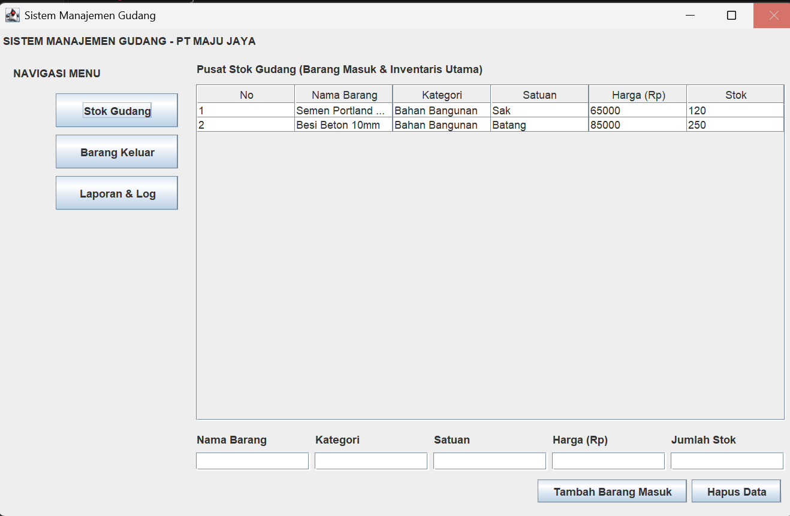
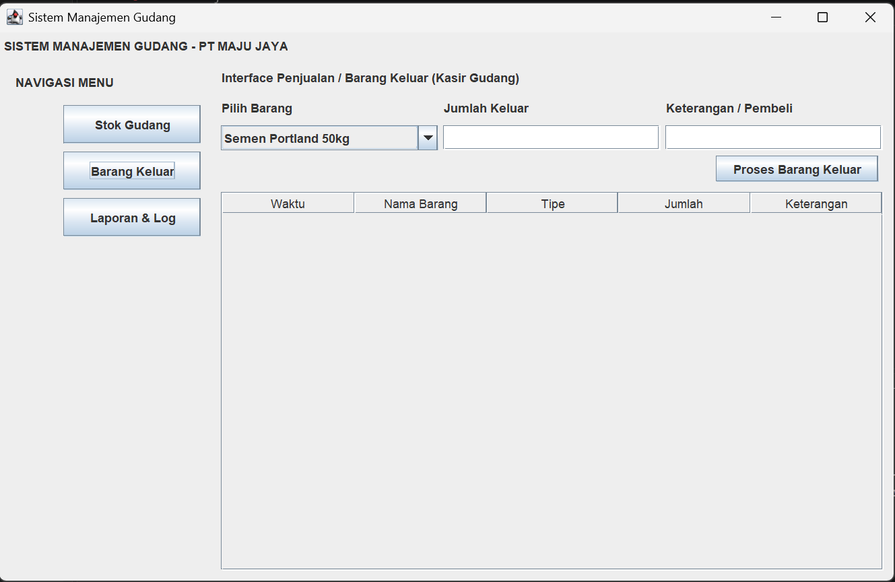
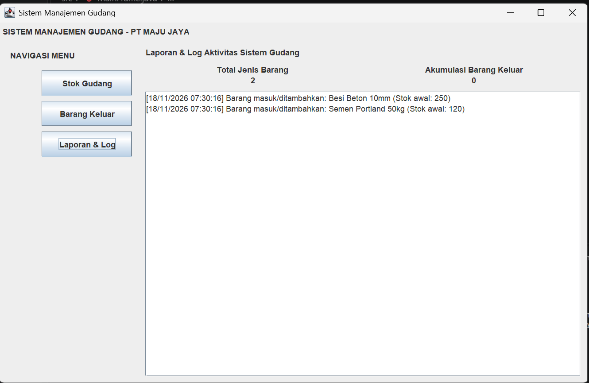

# Sistem Manajemen Gudang - Java Swing (GUI)

Aplikasi Desktop berbasis Java Swing untuk mengelola inventaris gudang, pencatatan stok masuk, transaksi barang keluar (penjualan/kasir), serta laporan log aktivitas secara *real-time*. Proyek ini dikembangkan untuk memenuhi tugas eksplorasi GUI dan *Event Handling* dalam mata kuliah Pemrograman Berbasis Objek.

---

## Fitur Utama

1. **Stok Gudang (Menu 1)**
   * Pusat penyimpanan data dan inventaris barang utama.
   * Manajemen penambahan barang masuk beserta informasi kategori, satuan, harga, dan jumlah stok awal.
   * Tabel inventaris yang dikunci secara profesional (*table header reordering disabled*) agar tata letak kolom tetap rapi dan tidak bisa digeser-geser oleh pengguna.

2. **Barang Keluar (Menu 2)**
   * Antarmuka khusus kasir/admin gudang untuk memproses transaksi barang keluar.
   * Validasi otomatis terhadap ketersediaan stok sebelum transaksi diproses.
   * Pencatatan keterangan pembeli/tujuan keluar secara akurat.

3. **Laporan & Log (Menu 3)**
   * Rekapitulasi statistik total jenis barang dan akumulasi barang keluar.
   * *Log* aktivitas sistem otomatis yang mencatat setiap aksi penambahan dan pengeluaran stok secara *real-time*.

---

##  Tangkapan Layar (Screenshots)

Berikut adalah antarmuka dari aplikasi Sistem Manajemen Gudang:

### 1. Tampilan Menu Stok Gudang
*(Tempat admin mengelola data barang masuk dan inventaris)*


### 2. Tampilan Menu Barang Keluar
*(Interface kasir untuk mencatat transaksi barang keluar)*


### 3. Tampilan Menu Laporan & Log
*(Rekapitulasi data dan log aktivitas sistem)*


---

## 🛠️ Konsep PBO & GUI yang Diterapkan

Proyek ini mengimplementasikan materi dasar hingga lanjutan Pemrograman Berbasis Objek pada GUI Java Swing:
* **Top-level Container Class**: Menggunakan `JFrame` (`MainFrame`) sebagai jendela utama aplikasi[cite: 64, 73].
* **Intermediate Container Class**: Menggunakan `JPanel` (`SidebarPanel`, `StokGudangPanel`, `BarangKeluarPanel`, `LaporanPanel`) untuk mengelompokkan komponen[cite: 64].
* **Atomic Component Class**: Memanfaatkan komponen interaktif seperti `JButton`, `JTextField`, `JComboBox`, `JTable`, dan `JTextArea`[cite: 68, 69].
* **Layout Managers**: Kombinasi penggunaan **`BorderLayout`**, **`BoxLayout`**, **`GridLayout`**, dan **`CardLayout`**[cite: 65].
* **Event Handling**: Penerapan *Delegation Event Model* menggunakan interface **`ActionListener`** serta *override* method `actionPerformed` untuk menangani aksi tombol dan navigasi menu[cite: 5, 9, 14, 15].

---

##  Cara Menjalankan Program

1. Pastikan Anda sudah menginstal **Java Development Kit (JDK)** di komputer Anda.
2. Clone atau download repositori ini ke direktori lokal Anda.
3. Buka terminal atau Command Prompt, lalu arahkan ke folder proyek.
4. Buat folder `bin` untuk menyimpan hasil kompilasi (jika belum ada):
   ```cmd
   mkdir bin